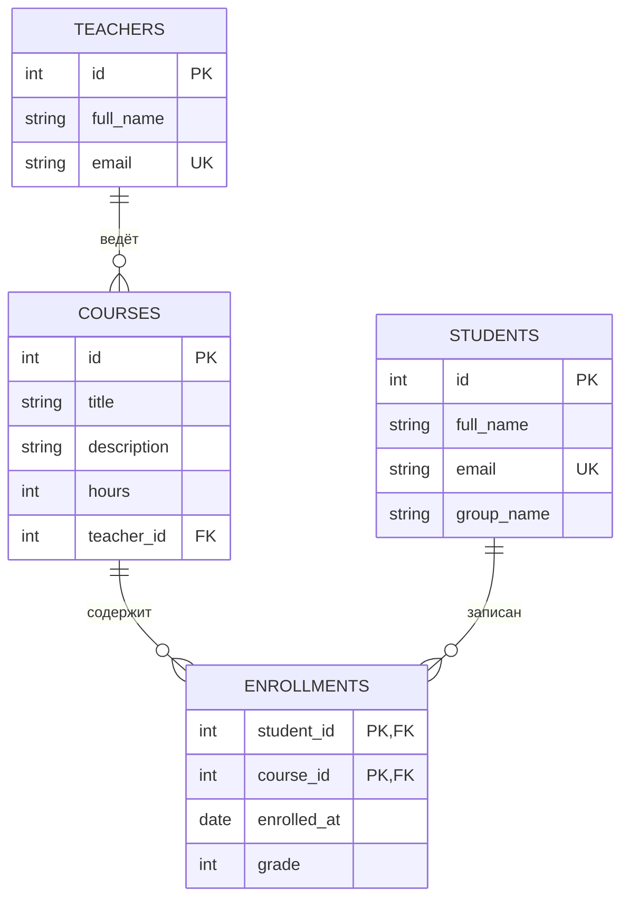

# Учебный центр: лабораторная работа (PostgreSQL, Sequelize, REST API)

## ER-диаграмма

## Нормальная форма

Схема находится в третьей нормальной форме. Все атрибуты атомарны (1НФ), а в таблице `enrollments` с составным ключом дата записи и оценка зависят от пары «студент + курс» целиком, а не от её части (2НФ). Нет транзитивных зависимостей: данные преподавателя хранятся только в `teachers`, а в `courses` лежит лишь ссылка `teacher_id`, поэтому имя и email преподавателя не дублируются. Так же сведения о студентах хранятся только в `students`, и аномалий обновления и удаления не возникает.